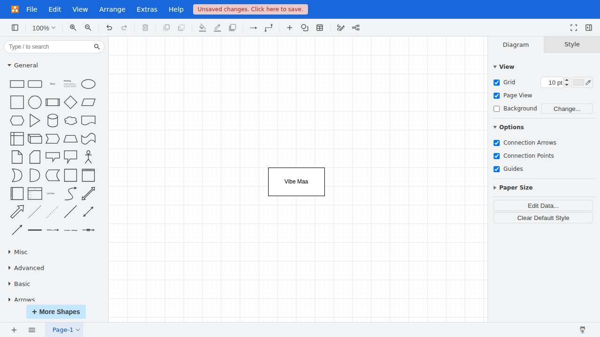

# vibe-maa

**让 AI 自己看界面，把自动化想法变成可运行的项目。**

vibe-maa 是面向编程 AI 的 [MaaFramework](https://github.com/MaaXYZ/MaaFramework) 开发环境。
你描述想完成的任务，AI 观察软件、探索操作、编写脚本，再根据真实运行结果不断修复，最终交付可重复执行的 MaaFW 项目。

> “帮我为这个软件实现自动化。先看看界面怎么操作，写出脚本，遇到新情况就继续调整，最后验证它确实完成了任务。”

## 从一句目标，到可运行的自动化

**描述目标 → 观察与探索 → 编写脚本 → 实际验证 → 修复完善 → 交付项目**

开发自动化需要反复理解界面和验证行为。vibe-maa 把这些工作接到编程 AI 的开发流程中，让它可以亲自试验，并从结果继续推进。

- **看得见软件**：AI 可以查看真实画面，探索按钮、页面和操作后的变化。
- **遇到问题能继续修**：失败现场和运行记录保留下来，帮助 AI 找到遗漏的界面或分支。
- **换个会话也能接着做**：目标、进度和验证记录属于项目，后续可以继续开发。
- **完成需要有依据**：脚本跑完后，还要检查任务目标是否满足。
- **留下可以维护的成果**：交付标准 MaaFW 脚本、素材与验证材料，便于重复运行和继续迭代。

## 给你的编程 AI 使用

vibe-maa 与 Codex、Claude Code 等编程 AI 配合工作。
你准备目标软件和运行环境，AI 使用工具完成探索、开发和验证；你可以把重点放在想实现什么、什么结果才算完成。

**[让 AI 开始使用 →](skills/vibe-maa/SKILL.md)** · [安装与接入](docs/getting-started.md) · [全部文档](docs/index.md)

适合从这些任务开始：

- 游戏日常与重复操作的脚本开发。
- 软件界面测试和回归检查。
- 将一段手动操作整理为可重复执行的流程。
- 在软件更新后，依据失败现场修复已有自动化。

## 已经在真实软件上验证

我们已经使用 `deepseek-flash`，通过开源编程 Agent 在真实的 diagrams.net / draw.io 中探索并开发自动化，产出脚本、图片素材、用例和任务文件，再从新会话独立重跑检查结果。

也验证了已有脚本遇到新启动弹窗和后续界面变化时，AI 根据失败现场重新观察、修改，再验证新旧起点的开发闭环。[查看这次自主修复的项目与证据](examples/agent-generated/drawio-change-low/README.md)。

项目的真实应用测试覆盖 Windows 和 Ubuntu。模型原始交付物与跨平台参考流程分别保留，成功、失败及适用范围都记录在[验收记录](docs/benchmarks.md)中。

这套开发方式也提供了可复位的起步示例，便于先让 AI 体验一次“发现遗漏 → 修改脚本 → 重新验证”的完整过程。

## 一起把自动化开发交给 AI

我们的目标是：你说出想完成的事情，AI 就能基于 MaaFramework 把自动化项目开发出来，并在变化中持续维护。

- [查看真实模型的交付物](examples/agent-generated/drawio-low-isolated/README.md)
- [了解正在推进的工作](ROADMAP.md)
- [参与贡献](CONTRIBUTING.md) · [查看版本变化](CHANGELOG.md)

License: [AGPL-3.0-only](LICENSE)。
