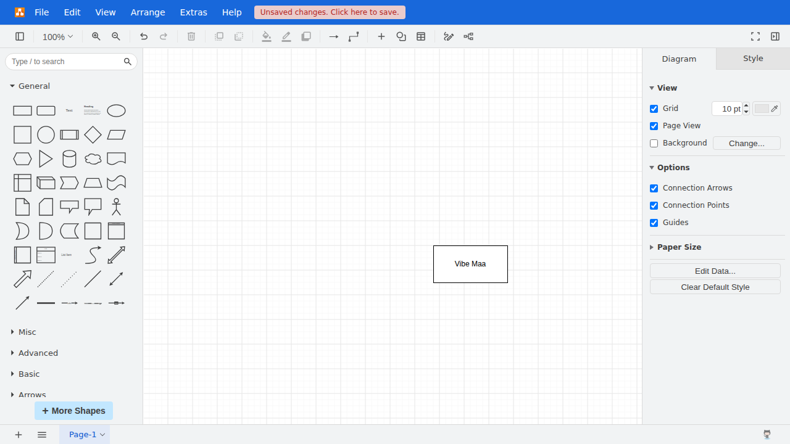

# AI-authored draw.io automation

This is the **unmodified deliverable** from `deepseek-flash` using the pinned open-source Codex CLI and vibe-maa tools. It creates a rectangle labelled `Vibe Maa` in the real, locally served draw.io app.

The agent explored screenshots, generated three templates, wrote a normal MaaFW Pipeline and added task/case files. Entry: `AgentTask`. No hand-written replacement Pipeline is used here.

Provenance and original archive checksum: [ORIGIN.json](ORIGIN.json). The original CI falsely rejected draw.io's internal `label` renderer name; the corrected independent oracle checks the real rectangular renderer, label and document state. Replay uses fresh application contexts and makes no model API call.

```bash
uv sync --locked --extra browser
uv run vibe-maa browser install
uv run python integration/agent/regrade.py --project examples/agent-generated/drawio --output work/drawio-replay
```

This is one task on one pinned application/UI, not evidence that arbitrary games or all starting states work. The authored recognition templates and cases remain application-specific.


